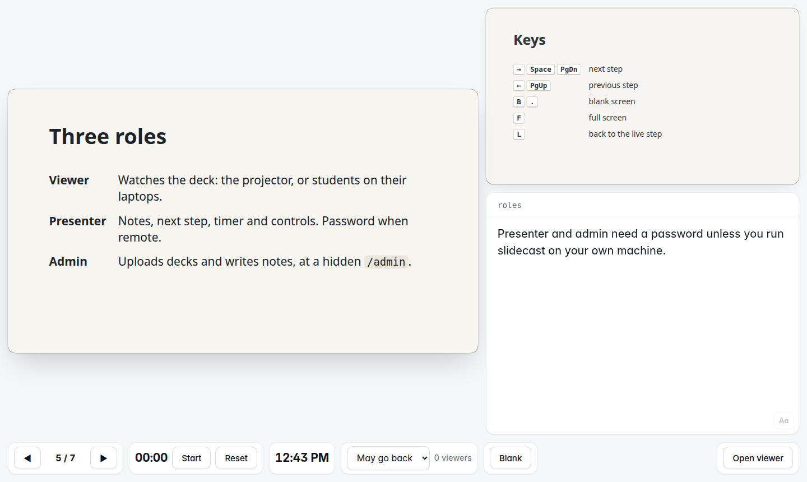

<p align="center"></p>
<h1 align="center">slidecast</h1>
<p align="center"><b>Present any HTML slide deck like you would in PowerPoint, with a presenter view, your phone as a remote, and audience screens that follow you live.</b></p>
<p align="center">
  <a href="https://github.com/Pablomg02/slidecast/actions/workflows/test.yml"></a>
  <a href="LICENSE"></a>
</p>

## What is slidecast?

More and more presentations are written as a web page: you ask an AI
assistant for a deck and get back one `index.html`. It looks great, but it
lacks what PowerPoint gives you on presentation day: speaker notes only you
can see, a preview of what comes next, a timer, a remote control, a second
screen for the audience.

slidecast adds all of that to any HTML deck. You run it on your computer (or
on a small server), open the **presenter view** on your screen and the
**viewer** on the projector, and from then on every screen showing the deck
moves with you: the projector, your phone, your audience's laptops.

<p align="center"></p>

- **Presenter view**: current and next slide, speaker notes, timer, clock,
  and a button to black out every screen. It also works on a phone.
- **Viewers in sync**: every screen follows your slides within a second.
- **Any remote**: keyboard, a presentation clicker, or your phone.
- **Notes in the browser**: write them slide by slide in the admin panel;
  they are saved next to the deck.
- **Made for AI decks**: a deck is just a folder with an `index.html`. The
  [deck format](docs/deck-format.md) includes a prompt to give your AI
  assistant.
- **Yours**: it runs on your computer, your network or your own server. No
  account, no cloud service, no tracking. English and Spanish interface.

## What you can do with it

From the simplest setup to the most complete one:

1. **A laptop and a projector.** A teacher plugs the laptop into the
   projector. The laptop screen shows the presenter view with notes and
   timer; the projector shows the slides. Exactly like PowerPoint's presenter
   mode, but for HTML.
2. **Your phone as a remote.** Leave the laptop on the lectern and walk
   around the room: the presenter view on your phone shows your notes and
   moves the slides on the projector.
3. **The audience follows on their own devices.** Students or colleagues open
   a link on their laptop or phone and see the slides there, in step with
   you. Handy in large rooms, for people at the back, or for anyone joining
   remotely.
4. **Everyone at their own pace.** You choose what viewers may do: stay
   locked to your slide, go back to re-read an earlier one (and return to
   you with one click), or browse the whole deck freely. You can change it in
   the middle of the talk.
5. **Interactive slides.** An HTML slide can contain anything a web page can:
   simulations, sliders, quizzes, live charts, videos. Each person can play
   with them on their own screen while you keep presenting.

A deck is a web page, so the possibilities are endless: if a browser can show
it, slidecast can present it.

## Getting started

### What you need

- **[Node.js](https://nodejs.org) 20 or newer.** Download the *LTS* version
  from its website and install it like any other program.
- **slidecast itself.** Either click the green **Code** button at the top of
  this page and choose **Download ZIP** (then unzip it), or, if you use git:

  ```bash
  git clone https://github.com/Pablomg02/slidecast.git
  ```

The commands below are typed in a terminal (on Windows: *PowerShell*) opened
in the slidecast folder.

### 1. On your own computer

This is all you need for a laptop and a projector.

```bash
npm install
./start.sh
```

On Windows, type `npm start` instead of `./start.sh` and then open
<http://127.0.0.1:4321/admin> in your browser.

Your browser opens slidecast's admin page. There:

1. Upload your deck: a single `.html` file, or a `.zip` with the deck's folder.
2. Click **Presenter** next to your deck.
3. Click **Open viewer** in the presenter view, drag that new window to the
   projector and press `F` for full screen.

That's it: move through the deck from the presenter view with the arrow keys
or a clicker. No password is needed while everything happens on your
computer. To stop slidecast, press `Ctrl+C` in the terminal or close it.

**No deck yet?** Try the demo: `node bin/slidecast.js serve examples/demo`
and open the address it prints.

### 2. On your local network

For your phone as a remote, or for an audience on the same Wi-Fi as you.

Other devices need a password to present, so set one first (8 characters or
more, with at least one letter and one digit). You only do this once:

```bash
node bin/slidecast.js passwd presenter
./start.sh --network
```

On Windows, the second line is `npm start -- --host 0.0.0.0`.

slidecast prints the addresses other devices can use, something like
`http://192.168.1.20:4321`. Then:

- **On your phone**, open `http://192.168.1.20:4321/<deck>/present` and type
  the presenter password.
- **Your audience** opens `http://192.168.1.20:4321/<deck>/view`; no password.

`<deck>` is the deck's *Name in URL* in the admin page. If you also want to
upload decks from another device, set an admin password too:
`node bin/slidecast.js passwd admin`.

> [!TIP]
> If the other devices cannot connect, check that they are on the same Wi-Fi,
> and that your computer's firewall allows connections on port 4321. Some
> public or university networks block connections between devices; in that
> case use one of the options in the next step.

### 3. From anywhere

To reach slidecast from other networks (your phone on mobile data, an audience
following from home, a server that is always on), see
**[Access from other networks](docs/remote-access.md)**. It covers:

- **Tailscale**, to connect your own devices (laptop and phone) wherever they
  are;
- **Cloudflare Tunnel**, to share a public link with anyone, from your own
  computer or from an always-on Raspberry Pi.

## Making decks

Any HTML presentation works best when slidecast knows where its slides are.
The quickest way to get one is to ask your AI assistant: copy the prompt in
**[docs/deck-format.md](docs/deck-format.md#instructions-for-your-ai-assistant)**,
add what your talk is about, and upload the `index.html` it gives you.

To start from a working example instead, run
`node bin/slidecast.js new my-talk` and edit `decks/my-talk/index.html`.

Speaker notes are written in the admin panel (**Edit notes**). They are
stored in a `deck.json` file next to the deck, so they travel with it.

## During the presentation

### Keys

These work in the presenter view, and most presentation clickers send them,
so clickers work out of the box.

| Key | Action |
| --- | --- |
| `→` `↓` `Space` `PageDown` `Enter` | Next step |
| `←` `↑` `Shift+Space` `PageUp` `Backspace` | Previous step |
| `Home` / `End` | First / last step |
| `B` or `.` | Black out every viewer's screen (press again to come back) |
| `F` | Full screen |
| `L` | In a viewer: back to the presenter's slide |

Clicker connected to the projector's computer instead of yours? When the
viewer window is allowed to present (on the computer running slidecast, or
after signing in as presenter), it shows a *Controlling* badge and the clicker
drives the presentation from there too. *Stop controlling* turns it back into
a plain viewer.

### What viewers may do

Chosen per deck in the admin panel, and switchable live from the presenter
view:

- **Follow**: viewers always see your slide.
- **May go back** (default): viewers can look at earlier slides, never ahead
  of you; a *Back to live* button returns to your slide.
- **Free**: viewers can browse the whole deck.

### Admin panel

At `/admin` you can upload and replace decks (replacing keeps the notes),
delete them (they go to a trash folder, never erased), edit notes, set
passwords, rename decks, choose each deck's viewer mode, and choose what
visitors see at the main address: one deck, the list of decks, or a page
asking for the link.

## Passwords and privacy

| Password | What it allows | Needed |
| --- | --- | --- |
| **Presenter** | Moving the slides. One for every deck, or one per deck. | When presenting from another device. |
| **Admin** | The admin panel. | When managing decks from another device. |
| **Viewer** (optional) | Watching one deck. | Only if you want to keep a deck private. |

On the computer running slidecast you are presenter and admin without any
password. From any other device, presenting and the admin panel stay closed
until you set the password. Set them with `node bin/slidecast.js passwd …` or
in the admin panel.

Passwords are stored only as one-way hashes, so nobody can read them back. If
you forget one, set a new one on the computer running slidecast:
`node bin/slidecast.js passwd admin` (or `presenter`); add `--clear` to remove
it.

Decks run in a sandbox: a deck written by an AI or downloaded from the
Internet cannot read your passwords or act as the admin. Details in
[docs/security.md](docs/security.md).

## Updating

- Downloaded as a ZIP: download the new version and copy your `decks` and
  `.slidecast` folders into it (they hold your decks, notes, passwords and
  settings).
- With git: `git pull && npm install`, then start it again.
- On a Raspberry Pi installed with the script: `sudo slidecast-update`.

## Reference

<details>
<summary><b>Addresses</b></summary>

| Address | Who | What |
| --- | --- | --- |
| `/` | everyone | The deck chosen in the admin panel, or the only deck; otherwise the list of decks or a page asking for the link. A signed-in admin always gets the list. |
| `/<deck>` | everyone | Choose viewer or presenter. |
| `/<deck>/view` | viewers | The deck, full window, following the presenter. |
| `/<deck>/present` | presenter | Current and next step, notes, timer, clock, controls. |
| `/admin` | admin | Decks, passwords and settings. |
| `/admin/edit/<deck>` | admin | Notes editor. |

</details>

<details>
<summary><b>Command line</b></summary>

```
slidecast serve [path] [--data dir] [--state dir] [--host h] [--port p] [--trust-proxy] [--open]
slidecast passwd admin | presenter [--deck slug [--viewer]] [--clear] [--state dir]
slidecast new <slug> [--data dir]
slidecast --help | --version
```

Run it as `node bin/slidecast.js …` from the slidecast folder, or install the
`slidecast` command for your user with `npm install -g .`.

- `serve <folder with index.html>` serves only that deck; `serve <folder>`
  serves every deck inside it. Default: `./decks`.
- Settings, password hashes, sessions and the live step go to `./.slidecast`.
  Both folders are ignored by git. When `./.slidecast` would end up inside the
  deck being served (`cd my-deck && slidecast serve .`), they go to
  `~/.config/slidecast` instead (`%APPDATA%\slidecast` on Windows).
- `--host 0.0.0.0` makes slidecast reachable from your network (default
  `127.0.0.1`, this computer only); default port `4321`.
- `--trust-proxy` is for Cloudflare Tunnel. Behind another proxy, make sure it
  overwrites `Cf-Connecting-IP` and `X-Forwarded-For`, or clients can choose
  their own address for the sign-in limits.
- Environment variables mirror the options: `SLIDECAST_HOST`,
  `SLIDECAST_PORT`, `SLIDECAST_DATA`, `SLIDECAST_STATE`,
  `SLIDECAST_TRUST_PROXY=1`.

</details>

## Documentation

- [Access from other networks](docs/remote-access.md): Tailscale and
  Cloudflare Tunnel.
- [Raspberry Pi with Cloudflare Tunnel](docs/deploy-raspberry.md): an
  always-on server, installed with one command.
- [Deck format](docs/deck-format.md): folder layout, `deck.json`, the API a
  deck exposes, and a prompt for your AI assistant.
- [Security](docs/security.md): threat model, protections, reporting a
  vulnerability.

## Contributing

Bug reports and ideas are welcome in
[Issues](https://github.com/Pablomg02/slidecast/issues). For security
problems, follow [SECURITY.md](SECURITY.md) instead of opening a public issue.

To work on the code:

```bash
npm install
npm test                          # unit and integration tests
npx playwright install chromium   # once
npm run test:e2e                  # browser tests
npm run check                     # syntax check
```

## License

[MIT](LICENSE) © Pablomg02
